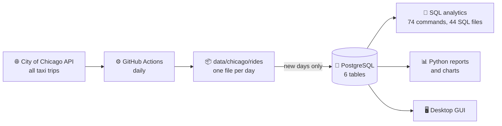

<div align="center">

# 🚕 TAXI DB

[Русский](README.md) · **English**

**A year of real Chicago taxi trips in PostgreSQL:<br>from the city's open API to SQL analytics, charts and a desktop GUI.**

[](https://github.com/DarkSwordman999/TAXI-db/releases/latest)
[](https://github.com/DarkSwordman999/TAXI-db/actions/workflows/tests.yml)
[](https://github.com/DarkSwordman999/TAXI-db/actions/workflows/lint.yml)
[](https://github.com/DarkSwordman999/TAXI-db/actions/workflows/parser.yml)


[](#license)

| **730,000** | **365** | **3,059** | **77** | **172** |
|:---:|:---:|:---:|:---:|:---:|
| trips | days in a row | taxi cabs | community areas | automated checks |

**[⬇️ Download the database](https://github.com/DarkSwordman999/TAXI-db/releases/latest)** · **[📚 Docs (in Russian)](docs/DATABASE.md)** · **[▶️ Run it yourself](#run-it-yourself)**

</div>

> The project, its database and its charts are in Russian: table and column names are Russian words
> (`ПОЕЗДКИ` = trips), so a query reads almost like a sentence for a Russian speaker.
> This page is a short English overview; translations of the names are given below.

<table>
<tr>
<td width="52%">

<picture>
  <source media="(prefers-color-scheme: dark)" srcset="docs/showcase/map-dark.png">
  
</picture>

</td>
<td>

### What the data shows

✈️ **The airport feeds the taxis.** O'Hare accounts for 19 % of all pickups. One trip in five starts or ends at the airport, and its average fare is **$57.93** against **$17.25** citywide.

🏙️ **The city runs on downtown.** Near North Side, the Loop and Near West Side give more than half of all pickups; the most frequent route is Loop ↔ Near North Side.

📈 **Fares are growing.** From December to September the average check rose by **28 %**, from $23.31 to $29.89.

📱 **Cash is losing ground.** The mobile app covers 38.6 % of trips, cards 32.5 %, cash 19.3 %.

Every fact is a single query against the project's database.

</td>
</tr>
</table>

<picture>
  <source media="(prefers-color-scheme: dark)" srcset="docs/showcase/rhythm-dark.png">
  
</picture>

<picture>
  <source media="(prefers-color-scheme: dark)" srcset="docs/showcase/check-dark.png">
  
</picture>

## The database

A star schema: the fact table `ПОЕЗДКИ` (trips) in the middle, five dimension tables around it.

<picture>
  <source media="(prefers-color-scheme: dark)" srcset="docs/showcase/er-dark.png">
  
</picture>

| Table | Meaning | What it holds | Rows |
|---|---|---|---:|
| 🚕 `ПОЕЗДКИ` | trips | when, which cab, from where to where, km and minutes, fare, tips, extras | 730,000 |
| 🧑‍✈️ `ВОДИТЕЛИ` | drivers | taxi cabs, identified by the city's anonymised hash | 3,059 |
| 🏢 `ТАКСОПАРКИ` | companies | from Flash Cab with 21 % of trips to single-cab owners | 33 |
| 💳 `КЛИЕНТЫ` | payment types | mobile app, card, cash… | 8 |
| 🗺️ `РАЙОНЫ` | community areas | Chicago's 77 community areas with centre coordinates | 77 |
| 🍂 `СЕЗОН` | seasons | month → season, for seasonal analytics | 12 |

### Built into the schema

| | |
|---|---|
| 🛡️ **10 `CHECK` rules** | fare, distance and duration are positive, a trip cannot end before it starts, area codes are 1–77 |
| 🔗 **5 foreign keys** | every trip has a real driver, company and payment type; a driver with trips cannot be deleted |
| ♻️ **Safe reloads** | each trip keeps the city's unique `trip_id`, so the same day cannot be loaded twice |
| ⚡ **6 indexes** | for the common filters: date, driver, company, payment type, areas |
| 🔍 **Fuzzy search** | `pg_trgm` finds "Flash Cab" even when you type "flsh cab" |
| 🕶️ **Anonymised data** | the city hides the cab behind a hash, rounds time to 15 minutes and location to the area |

### Functions and views

Six PL/pgSQL functions, each answering a question people ask such a database:

| Question | Function | Answer on the data |
|---|---|---|
| How much did a driver earn? | `get_driver_revenue` | driver #543 — $26,476.61 |
| …and how much of it in cash? | `get_driver_revenue_by_client` | $26,045.53, i.e. 98 % |
| Who earned more than a threshold? | `drivers_above_revenue` | above $20,000 — 5 drivers |
| What is a company's average check? | `get_company_avg_revenue` | Flash Cab — $22.37 |
| When does a company earn the most? | `revenue_by_company_and_season` | Flash Cab — in autumn, $881,376 |
| How does each driver get paid? | `display_pivot_table` | pivot table "drivers × payment types" |

Two views hide the six-table join: `v_rides_user` shows trips with names, for people; `v_rides_tech` shows codes and source IDs, for checks. Every field, constraint and function is described in [docs/DATABASE.md](docs/DATABASE.md) (in Russian).

## How it works



The collector fetches missing days on its own and commits them to the repository. The loader reads only the days that are not in the database yet, so an update takes seconds. Every change is checked in CI: the tests start a clean PostgreSQL, build the database from scratch and run all 44 SQL files, 74 commands and the reports; ruff and shellcheck check the code, and unit tests cover the collector and the loader.

## What the project demonstrates

| | |
|---|---|
| 🗄️ **Database design** | star schema, keys, integrity constraints, indexes for real queries |
| 📜 **SQL and PL/pgSQL** | all kinds of JOIN, subqueries, window functions, views, functions, pivot tables |
| 🔄 **ETL** | collection from a REST API, filtering of bad records, loading without duplicates |
| 🐍 **Python** | `psycopg2`, `matplotlib` charts, a `tkinter` desktop app |
| ⚙️ **Automation** | daily collection, end-to-end tests, ruff, shellcheck and unit tests in GitHub Actions on Ubuntu 26.04 and PostgreSQL 18 |

## About the data

Source: [Chicago Data Portal, Taxi Trips](https://data.cityofchicago.org/resource/ajtu-isnz.json) — all trips of licensed Chicago taxis, published monthly and anonymised by the city.

Chicago has about 18,000 taxi trips a day; the database keeps an even sample of 2,000 trips for each day. Shares and averages in the sample are close to the whole city, while totals refer to the sample only:

| | Sample in the database | All Chicago taxis |
|---|---:|---:|
| trips | 730,000 | 6,546,819 |
| metered revenue | $15.6 M | $139.3 M |
| revenue with tips and extras | $19.1 M | $171.4 M |

Period: 1 October 2025 – 30 September 2026.

## Run it yourself

**The fastest way** is to download the ready database from the [latest release](https://github.com/DarkSwordman999/TAXI-db/releases/latest) (`taxi.sql.gz`) and restore it into PostgreSQL 13 or newer:

```bash
createdb taxi
curl -L https://github.com/DarkSwordman999/TAXI-db/releases/latest/download/taxi.sql.gz | gunzip | psql -q -d taxi
```

Building from the repository, with all commands, reports and the GUI:

```bash
git clone https://github.com/DarkSwordman999/TAXI-db.git && cd TAXI-db
createdb taxi
python3 -m pip install -r requirements.txt
./help.sh rebuild     # schema, dimensions and 730,000 trips, ~3 minutes
./help.sh             # menu of all commands
./run_app.sh          # desktop GUI
```

On Windows the same steps are `.\help.cmd` and `.\run_app.cmd`: they find bash from Git for Windows and switch the console to UTF-8. The connection is taken from the standard `PGDATABASE`, `PGHOST`, `PGPORT`, `PGUSER`, `PGPASSWORD` variables or from a `.env` file (see `.env.example`). All commands are listed in [docs/COMMANDS.md](docs/COMMANDS.md) (in Russian).

## Author

**DarkSwordman999** — [GitHub profile](https://github.com/DarkSwordman999). Questions, bugs and ideas go to [Issues](https://github.com/DarkSwordman999/TAXI-db/issues).

## License

**Noncommercial use only.** You may view, study, run and modify the project for learning, personal and research purposes; commercial use is not allowed.

- **Code** (SQL, Python, scripts, GUI, tests) — [PolyForm Noncommercial 1.0.0](https://polyformproject.org/licenses/noncommercial/1.0.0).
- **The assembled database** (`data/chicago/` and the dump in releases) **and the documentation** (`docs/`) — [CC BY-NC 4.0](https://creativecommons.org/licenses/by-nc/4.0/): with attribution and not for commercial purposes.

The original trips are open data from the [City of Chicago Data Portal](https://data.cityofchicago.org) under the [city's terms](https://www.chicago.gov/city/en/narr/foia/data_disclaimer.html); for business use, take them directly from the city's API. The full terms are in [LICENSE](LICENSE). For a commercial license, contact the author via [GitHub](https://github.com/DarkSwordman999).
