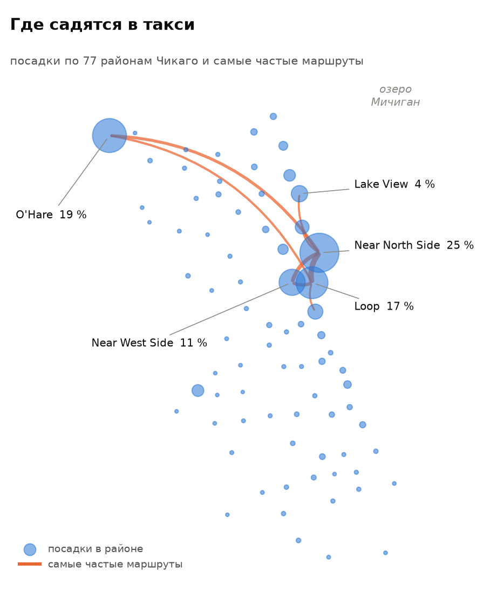
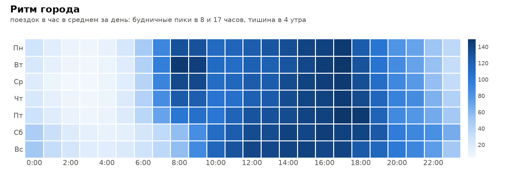
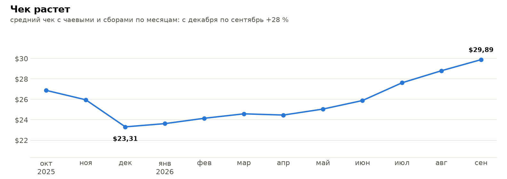
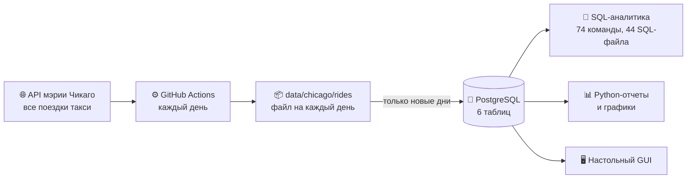

<div align="center">

# 🚕 TAXI DB

**Русский** · [English](README.en.md)

**Год реальных поездок такси Чикаго в PostgreSQL:<br>от открытого API мэрии до SQL-аналитики, графиков и собственного GUI.**

[](https://github.com/DarkSwordman999/TAXI-db/releases/latest)
[](https://github.com/DarkSwordman999/TAXI-db/actions/workflows/tests.yml)
[](https://github.com/DarkSwordman999/TAXI-db/actions/workflows/lint.yml)
[](https://github.com/DarkSwordman999/TAXI-db/actions/workflows/parser.yml)


[](#лицензия)

| **730 000** | **365** | **3 059** | **77** | **172** |
|:---:|:---:|:---:|:---:|:---:|
| поездок | дней подряд | машин такси | районов города | автопроверок |

**[⬇️ Скачать готовую базу](https://github.com/DarkSwordman999/TAXI-db/releases/latest)** · **[📚 Документация](docs/DATABASE.md)** · **[📖 Инструкция пользователя](docs/USER_GUIDE.md)** · **[▶️ Запустить у себя](#запустить-у-себя)**

</div>

<table>
<tr>
<td width="52%">

<picture>
  <source media="(prefers-color-scheme: dark)" srcset="docs/showcase/map-dark.png">
  
</picture>

</td>
<td>

### Что видно в данных

✈️ **Аэропорт кормит такси.** O'Hare — 19 % всех посадок. Каждая пятая поездка начинается или заканчивается в аэропорту, а ее средний чек **$57,93** против **$17,25** у остальных поездок.

🏙️ **Город держится на центре.** Near North Side, Loop и Near West Side дают больше половины посадок, а самый частый маршрут — Loop ↔ Near North Side.

📈 **Чек растет.** С декабря по сентябрь средний чек вырос на **28 %**: с $23,31 до $29,89.

📱 **Наличные сдают позиции.** Приложение — 38,6 % поездок, карта — 32,5 %, наличные — 19,3 %.

Каждый факт — один запрос к базе проекта.

</td>
</tr>
</table>

<picture>
  <source media="(prefers-color-scheme: dark)" srcset="docs/showcase/rhythm-dark.png">
  
</picture>

<picture>
  <source media="(prefers-color-scheme: dark)" srcset="docs/showcase/check-dark.png">
  
</picture>

## База данных

Схема «звезда»: в центре таблица фактов `ПОЕЗДКИ`, вокруг пять справочников. Все имена русские, поэтому запрос к базе читается почти как обычная фраза.

<picture>
  <source media="(prefers-color-scheme: dark)" srcset="docs/showcase/er-dark.png">
  
</picture>

| Таблица | Что в ней | Строк |
|---|---|---:|
| 🚕 `ПОЕЗДКИ` | когда, кто вез, откуда и куда, сколько км и минут, стоимость, чаевые, сборы | 730 000 |
| 🧑‍✈️ `ВОДИТЕЛИ` | машины такси, город указывает их обезличенным хэшем | 3 059 |
| 🏢 `ТАКСОПАРКИ` | таксопарки: от Flash Cab с 21 % поездок до таксистов-одиночек | 33 |
| 💳 `КЛИЕНТЫ` | способы оплаты: приложение, карта, наличные… | 8 |
| 🗺️ `РАЙОНЫ` | 77 районов Чикаго с координатами центра | 77 |
| 🍂 `СЕЗОН` | месяц → время года, для сезонной аналитики | 12 |

### Одна поездка изнутри

Так поездка выглядит в представлении `v_rides_user`, где вместо кодов уже подставлены названия:

| Поле | Значение | |
|---|---|---|
| дата | 12.06.2026, 19:00 | вечер пятницы |
| водитель | Водитель №1756 | |
| таксопарк | Flash Cab | крупнейший в городе |
| оплата | банковская карта | |
| откуда → куда | O'Hare → Loop | из аэропорта в деловой центр |
| расстояние | 26,9 км | |
| время | **72 минуты** | пробка видна прямо в данных |
| стоимость + чаевые | $44,75 + $10,65 | чаевые 24 % |

### Что заложено в схему

| | |
|---|---|
| 🛡️ **10 правил `CHECK`** | стоимость, пробег и время больше нуля, поездка не кончается раньше начала, у района код от 1 до 77. Неправдоподобная строка в базу не попадет |
| 🔗 **5 внешних ключей** | у каждой поездки есть настоящий водитель, таксопарк и способ оплаты. Удалить водителя, у которого есть поездки, база не даст |
| ♻️ **Повторная загрузка безопасна** | у каждой поездки уникальный `trip_id` из данных города, поэтому загрузить один день дважды невозможно |
| ⚡ **6 индексов** | под частые фильтры: дата, водитель, таксопарк, способ оплаты, районы |
| 🔍 **Поиск по похожим названиям** | расширение `pg_trgm` находит «Flash Cab», даже если ввести «flsh cab» |
| 🕶️ **Обезличенные данные** | город прячет машину за хэшем, округляет время до 15 минут, а место — до района |

### Функции и представления

Шесть функций на PL/pgSQL. Каждая отвечает на вопрос, который обычно задают такой базе:

| Вопрос | Функция | Ответ на данных |
|---|---|---|
| Сколько заработал водитель? | `get_driver_revenue` | водитель №543 — $26 476,61 |
| …и сколько из этого наличными? | `get_driver_revenue_by_payment` | $26 045,53, то есть 98 % |
| Кто заработал больше порога? | `drivers_above_revenue` | больше $20 000 — 5 водителей |
| Какой средний чек у таксопарка? | `get_company_avg_revenue` | Flash Cab — $22,37 |
| Когда таксопарк зарабатывает больше всего? | `revenue_by_company_and_season` | Flash Cab — осенью, $881 376 |
| Как каждый водитель получает деньги? | `display_pivot_table` | сводная таблица «водители × способы оплаты» |

Сводная таблица для трех водителей с наибольшей выручкой:

| Водитель | Карта | Наличные | Приложение | Предоплата |
|---|---:|---:|---:|---:|
| №543 | $278 | **$26 046** | $29 | $125 |
| №1912 | $202 | $1 167 | $1 403 | **$23 658** |
| №2211 | $64 | $1 198 | $22 | **$22 205** |

У всех троих почти все деньги приходят одним способом: у одного наличными, у двух других предоплатой.

Два представления скрывают соединение шести таблиц: `v_rides_user` показывает поездки с названиями, для людей, а `v_rides_tech` — с кодами и исходными ID, для проверок.

Каждое поле, ограничение и функция подробно описаны в [docs/DATABASE.md](docs/DATABASE.md).

## Как это устроено



Сборщик сам докачивает пропущенные дни и сохраняет их в репозиторий. Загрузчик читает только дни, которых еще нет в базе, поэтому обновление занимает секунды. Каждое изменение проверяют автотесты: они поднимают чистый PostgreSQL, собирают базу с нуля и прогоняют все 44 SQL-файла, 74 команды и отчеты. Отдельно ruff и shellcheck проверяют код, а модульные тесты — сборщик и загрузчик.

## Что показывает проект

| | |
|---|---|
| 🗄️ **Проектирование БД** | схема «звезда», ключи, ограничения целостности, индексы под реальные запросы |
| 📜 **SQL и PL/pgSQL** | JOIN всех видов, подзапросы, оконные функции, представления, функции, сводные таблицы |
| 🔄 **ETL** | сбор из REST API, отсев брака, загрузка без дублей |
| 🐍 **Python** | `psycopg2`, графики `matplotlib`, настольное приложение на `tkinter` |
| ⚙️ **Автоматизация** | ежедневный сбор, автотесты, ruff, shellcheck и модульные тесты в GitHub Actions на Ubuntu 26.04 и PostgreSQL 18 |
| 📚 **Документация** | описание базы в [Markdown](docs/DATABASE.md) и [Word](docs/DATABASE.docx), [справочник команд](docs/COMMANDS.md), [инструкция пользователя](docs/USER_GUIDE.md) |

## О данных

Источник — [Chicago Data Portal, Taxi Trips](https://data.cityofchicago.org/resource/ajtu-isnz.json): все поездки лицензированных такси Чикаго. Город публикует их помесячно и обезличивает.

В Чикаго около 18 000 поездок в день, в базу попадает равномерная выборка из 2000 поездок за каждый день. Доли и средние по выборке близки к картине по всему городу, а суммы относятся только к выборке:

| | Выборка в базе | Все такси Чикаго |
|---|---:|---:|
| поездок | 730 000 | 6 546 819 |
| выручка по счетчику | $15,6 млн | $139,3 млн |
| итог с чаевыми, сборами и доплатами | $19,1 млн | $171,4 млн |

Период — с 01.10.2025 по 30.09.2026.

## Запустить у себя

**Быстрее всего** — скачать готовую базу со [страницы последнего релиза](https://github.com/DarkSwordman999/TAXI-db/releases/latest) (файл `taxi.sql.gz`) и восстановить ее в PostgreSQL 13 или новее. Загружать поездки не нужно.

<details>
<summary><b>Команды: готовая база, сборка из репозитория, Windows, подключение</b></summary>

Готовая база из релиза:

```bash
createdb taxi
curl -L https://github.com/DarkSwordman999/TAXI-db/releases/latest/download/taxi.sql.gz | gunzip | psql -q -d taxi
```

Сборка из репозитория, со всеми командами, отчетами и GUI:

```bash
git clone https://github.com/DarkSwordman999/TAXI-db.git && cd TAXI-db
createdb taxi
python3 -m pip install -r requirements.txt
./help.sh rebuild     # схема, справочники и 730 000 поездок, ~3 минуты
./help.sh             # меню всех команд
./run_app.sh          # графический интерфейс
```

В Windows те же шаги делают `.\help.cmd` и `.\run_app.cmd`: они находят bash из Git for Windows и включают в консоли UTF-8. Обычно нужен пользователь `postgres`: `createdb -U postgres taxi`.

Подключение к PostgreSQL берется из стандартных переменных `PGDATABASE`, `PGHOST`, `PGPORT`, `PGUSER`, `PGPASSWORD` или из файла `.env` (образец — `.env.example`). Без них используется локальный сервер и база `taxi`.

Новые месяцы данных приходят сами: `git pull` и `./help.sh load`. Все команды — в [docs/COMMANDS.md](docs/COMMANDS.md), подробная инструкция с решением частых проблем — в [docs/USER_GUIDE.md](docs/USER_GUIDE.md).

</details>

<details>
<summary><b>Структура проекта</b></summary>

```text
TAXI-db/
├── help.sh, help.cmd              SQL-команды
├── python_reports.sh, .cmd        Python-отчеты
├── run_app.sh, .cmd               графический интерфейс
├── taxi_report.py                 Python-отчеты и графики
├── app/                           GUI: главное окно и модули
├── data/chicago/                  районы и поездки, файл на каждый день
├── docs/                          документация, схема, картинки для README
├── helper/, queries/              SQL-запросы, представления, функции
├── parser/                        сбор из API и загрузка в базу
├── schema/, setup/                таблицы, индексы, пересборка базы
├── tests/                         автотесты (run_all.sh) и модульные тесты (unit/)
└── .github/workflows/             сбор данных, автотесты, проверка кода
```

Картинки для README строит `python docs/make_showcase.py`, Word-документацию — `python docs/make_docs.py`. Автотесты локально: `PGDATABASE=taxi_test tests/run_all.sh`. Проверка кода: `pip install -r requirements-dev.txt`, затем `ruff check .`, `shellcheck *.sh */*.sh` и `python -m unittest discover -s tests/unit`.

</details>

## Автор

**DarkSwordman999** — [профиль на GitHub](https://github.com/DarkSwordman999). Вопросы, ошибки и идеи — в [Issues](https://github.com/DarkSwordman999/TAXI-db/issues).

## Лицензия

**Только для некоммерческого использования.** Смотреть, изучать, запускать и менять проект для учебы, личных и исследовательских целей можно; коммерческое использование запрещено.

- **Код** (SQL, Python, скрипты, GUI, тесты) — [PolyForm Noncommercial 1.0.0](https://polyformproject.org/licenses/noncommercial/1.0.0).
- **Собранная база** (`data/chicago/` и дамп в релизах) **и документация** (`docs/`) — [CC BY-NC 4.0](https://creativecommons.org/licenses/by-nc/4.0/deed.ru): со ссылкой на автора и не в коммерческих целях.

Исходные поездки — открытые данные [City of Chicago Data Portal](https://data.cityofchicago.org) по [условиям города](https://www.chicago.gov/city/en/narr/foia/data_disclaimer.html). Если они нужны для бизнеса, их можно взять напрямую из API города. Полный текст условий — в [LICENSE](LICENSE). За коммерческой лицензией — к автору через [GitHub](https://github.com/DarkSwordman999).
