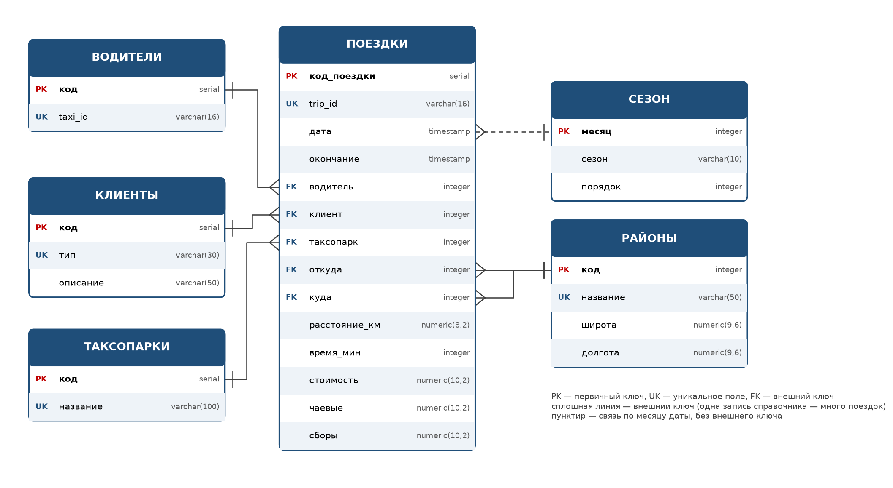

# TAXI DB

[](https://github.com/DarkSwordman999/TAXI-db/actions/workflows/tests.yml)
[](https://github.com/DarkSwordman999/TAXI-db/actions/workflows/parser.yml)


База данных PostgreSQL на реальных поездках такси Чикаго. Год данных: **730 000 поездок**, 3 000 машин, 33 таксопарка, 77 районов города. Поездки каждый день собираются из открытого API мэрии, лежат прямо в репозитории и загружаются в базу одной командой.


**Что внутри**

- схема из шести таблиц с внешними ключами, проверками и индексами;
- 70 команд `help.sh` и 56 SQL-файлов: JOIN, подзапросы, аналитика, запросы с параметрами;
- представления и функции PL/pgSQL;
- Python-отчеты и графики matplotlib;
- графический интерфейс на tkinter: просмотр, фильтры, отчеты, графики, правка записей;
- ежедневный сбор данных и автотесты в GitHub Actions.

**Документация**

| Документ | О чем |
|---|---|
| [docs/DATABASE.md](docs/DATABASE.md) · [Word](docs/DATABASE.docx) | устройство базы: таблицы, поля, связи, функции, загрузка данных |
| [docs/COMMANDS.md](docs/COMMANDS.md) | все команды `help.sh` и `python_reports.sh` |

## Быстрый старт

Нужны PostgreSQL, Python 3 и Git. В Windows bash берется из Git for Windows.

**Linux и macOS**

```bash
git clone https://github.com/DarkSwordman999/TAXI-db.git && cd TAXI-db
createdb taxi
python3 -m pip install -r requirements.txt
./help.sh rebuild     # схема, справочники и все поездки, ~3 минуты
./help.sh task1       # выручка по сезонам
./run_app.sh          # графический интерфейс
```

**Windows (PowerShell или cmd)**

```powershell
git clone https://github.com/DarkSwordman999/TAXI-db.git; cd TAXI-db
createdb -U postgres taxi
python -m pip install -r requirements.txt
.\help.cmd rebuild
.\help.cmd task1
.\run_app.cmd
```

Обертки `.cmd` находят bash из Git for Windows, включают в консоли UTF-8 и запускают одноименный `.sh` с теми же параметрами. Дальше в примерах используется `./help.sh`; в Windows то же самое делает `.\help.cmd`.

Если подключение к PostgreSQL отличается от стандартного, скопируйте `.env.example` в `.env` и укажите свои значения (см. [Подключение](#подключение)).

## Данные

Источник — [Chicago Data Portal, Taxi Trips](https://data.cityofchicago.org/resource/ajtu-isnz.json): все поездки лицензированных такси Чикаго. Город публикует их с задержкой около двух недель и обезличивает: машина указана хэшем, о пассажире известен только способ оплаты, время округлено до 15 минут, места — до района.

За день в Чикаго около 18 000 поездок. В репозиторий попадает равномерная выборка: 2000 поездок за каждый день, один файл `data/chicago/rides/ГГГГ/ГГГГ-ММ-ДД.csv.gz` на день. Сейчас в репозитории 365 дней, с 01.10.2025 по 30.09.2026, 28 МБ.

Доли и средние значения по выборке близки к картине по всему городу. Суммы относятся только к выборке, реальные примерно в 9 раз больше:

| Показатель | Выборка в базе | Все такси Чикаго |
|---|---:|---:|
| поездок | 730 000 | 6 546 819 |
| выручка по счетчику | $15,6 млн | $139,3 млн |
| выручка с чаевыми и сборами | $19,1 млн | $171,4 млн |

| Показатель | Значение |
|---|---:|
| средний чек | $21,31 |
| средняя поездка | 10,2 км, 19 мин |
| поездок с чаевыми | 41,8 % |
| крупнейший таксопарк | Flash Cab, 21 % поездок |
| оплата | приложение 38,6 %, карта 32,5 %, наличные 19,3 % |


### Обновление

GitHub Actions каждый день скачивает новые дни и коммитит их в репозиторий. Чтобы добавить их в свою базу:

```bash
git pull
./help.sh load        # загружает только дни, которых еще нет в базе
```

Скачать недостающие дни самому, без GitHub Actions: `./help.sh fetch` (последние 45 дней) или `./help.sh fetch 365`, затем `./help.sh load`.

Как устроены сбор, отбор и загрузка — в [DATABASE.md, раздел 8](docs/DATABASE.md#8-загрузка-данных).

## База данных



| Таблица | Что хранит | Строк |
|---|---|---:|
| `ПОЕЗДКИ` | время, водитель, тип клиента, таксопарк, районы, км, минуты, стоимость, чаевые, сборы | 730 000 |
| `ВОДИТЕЛИ` | такси с водителем: обезличенный `taxi_id` | ~3 000 |
| `ТАКСОПАРКИ` | таксопарки | 33 |
| `КЛИЕНТЫ` | типы клиентов по способу оплаты | 8 |
| `РАЙОНЫ` | 77 районов Чикаго с координатами | 77 |
| `СЕЗОН` | месяц → сезон | 12 |

Представления: `v_rides_user` (поездки с названиями вместо кодов) и `v_rides_tech` (с кодами и исходными ID). Функции: выручка водителя, водители выше порога, выручка по таксопаркам и сезонам, сводная таблица водители × способы оплаты.

Подробно о каждом поле, ограничениях, индексах и функциях — в [docs/DATABASE.md](docs/DATABASE.md) и в той же документации [в формате Word](docs/DATABASE.docx).

## Команды

`./help.sh` без параметров показывает меню всех команд. Самые нужные:

| Команда | Что делает |
|---|---|
| `./help.sh rebuild` | пересоздать базу и загрузить все поездки |
| `./help.sh load` | загрузить новые дни |
| `./help.sh count` | сколько поездок и за какой период |
| `./help.sh task1` … `task4 N` | основные задачи: выручка по сезонам, таксопаркам, дням недели |
| `./help.sh top-drivers` | топ-10 водителей по выручке |
| `./help.sh by-month` | выручка по месяцам |
| `./help.sh driver 12` | сводка по водителю № 12 |
| `./help.sh func-pivot` | сводная таблица водители × способы оплаты |
| `./help.sh файл.sql [параметр]` | выполнить любой SQL-файл проекта |
| `./python_reports.sh all` | все Python-отчеты и графики |

У SQL-команд есть и прежние номера: `./help.sh 01` = `./help.sh companies`. Полный список — в [docs/COMMANDS.md](docs/COMMANDS.md).

## Графический интерфейс

`./run_app.sh` (в Windows `.\run_app.cmd`):

- дашборд с ключевыми показателями;
- поездки с фильтрами по таксопарку, водителю, оплате, районам, дате и сумме;
- рейтинги и отчеты по периодам, дням недели и часам, проверка качества данных;
- графики;
- добавление, изменение и удаление записей, UPDATE и DELETE с состоянием до и после;
- триграммный поиск по названиям (`pg_trgm`);
- экспорт в CSV, резервная копия через `pg_dump`;
- запуск SQL-файлов и всех команд `help.sh` и `python_reports.sh` кнопками.

## Подключение

Скрипты, GUI и Python-отчеты берут настройки из стандартных переменных PostgreSQL или из файла `.env` в корне проекта (образец — `.env.example`, сам `.env` в git не попадает):

| Переменная | По умолчанию |
|---|---|
| `PGDATABASE` | `taxi` |
| `PGHOST` | `localhost` |
| `PGPORT` | `5432` |
| `PGUSER` | имя пользователя ОС (в Windows обычно нужно `postgres`) |
| `PGPASSWORD` | пусто |

## Тесты

`tests/run_all.sh` пересобирает отдельную тестовую базу и прогоняет все команды `help.sh`, все SQL-файлы и все Python-отчеты. Он также проверяет, что ошибки дают ненулевой код. Прогон останавливается на первой ошибке.

```bash
PGDATABASE=taxi_test tests/run_all.sh                  # ~5 минут, база создается сама
PGDATABASE=taxi_test SKIP_REBUILD=1 tests/run_all.sh   # без пересборки
```

С рабочей базой `taxi` тест не запускается, папку `docs/` не меняет. В GitHub он проходит при каждом push и pull request на PostgreSQL 18 — значок «Автотесты» вверху.

## Структура проекта

```text
TAXI-db/
├── help.sh, help.cmd              SQL-команды
├── python_reports.sh, .cmd        Python-отчеты
├── run_app.sh, .cmd               графический интерфейс
├── run_sql.sh                     запуск SQL-файла с параметром
├── taxi_report.py                 Python-отчеты и графики
├── app/
│   ├── gui.py                     главное окно GUI
│   ├── taxi_gui/                  модули GUI: SQL, просмотр, аналитика, правка, скрипты
│   └── scripts/db_config.py       настройки подключения
├── data/
│   ├── chicago/community_areas.csv    районы Чикаго
│   ├── chicago/rides/ГГГГ/*.csv.gz    поездки, файл на каждый день
│   └── season/                        справочник сезонов
├── docs/                          документация, схема базы, графики
├── helper/                        вспомогательные запросы
├── parser/
│   ├── chicago_fetch.py           сбор из API Чикаго
│   └── load_rides.py              загрузка в базу
├── queries/                       задачи, подзапросы, представления, функции, изменение данных
├── schema/                        таблицы и индексы
├── setup/                         полная пересборка базы
├── tests/run_all.sh               автотесты
└── .github/workflows/             сбор данных и автотесты
```

## Примечания

- Имена таблиц и полей русские, поэтому терминал должен работать в UTF-8. В Windows это делают обертки `.cmd`; служебные надписи psql там выводятся по-английски (`(1 row)`), данные остаются русскими.
- Названия таксопарков и районов — как в данных города, на английском.
- `.gitattributes` закрепляет переводы строк: `.sh` всегда с LF, иначе bash их не выполнит.
- Документацию в Word пересобирает `python docs/make_docs.py` из `docs/DATABASE.md`.
