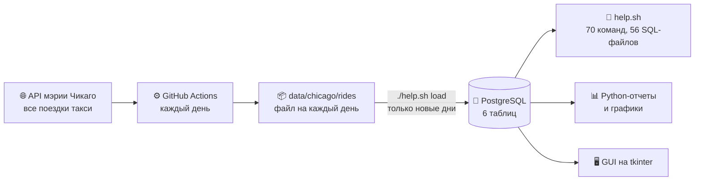

<div align="center">

# 🚕 TAXI DB

**Год реальных поездок такси Чикаго в PostgreSQL:<br>от открытого API мэрии до SQL-аналитики, графиков и собственного GUI.**

[](https://github.com/DarkSwordman999/TAXI-db/actions/workflows/tests.yml)
[](https://github.com/DarkSwordman999/TAXI-db/actions/workflows/parser.yml)


| **730 000** | **365** | **3 059** | **77** | **157** |
|:---:|:---:|:---:|:---:|:---:|
| поездок | дней подряд | машин такси | районов города | автопроверок |

</div>

<table>
<tr>
<td width="52%">

<picture>
  <source media="(prefers-color-scheme: dark)" srcset="docs/showcase/map-dark.png">
  
</picture>

</td>
<td>

### Что видно в данных

✈️ **Аэропорт кормит такси.** O'Hare — 19 % всех посадок. Каждая пятая поездка начинается или заканчивается в аэропорту, а ее средний чек **$57,93** против **$17,25** по городу.

🏙️ **Город держится на центре.** Near North Side, Loop и Near West Side дают больше половины посадок, а самый частый маршрут — Loop ↔ Near North Side.

📈 **Чек растет.** С декабря по сентябрь средний чек вырос на **28 %**: с $23,31 до $29,89.

📱 **Наличные сдают позиции.** Приложение — 38,6 % поездок, карта — 32,5 %, наличные — 19,3 %.

Все это — обычные SQL-запросы к базе проекта.

</td>
</tr>
</table>

<picture>
  <source media="(prefers-color-scheme: dark)" srcset="docs/showcase/rhythm-dark.png">
  
</picture>

<picture>
  <source media="(prefers-color-scheme: dark)" srcset="docs/showcase/check-dark.png">
  
</picture>

## Как это устроено



Сборщик сам докачивает пропущенные дни и коммитит их в репозиторий. Загрузчик берет из базы список уже загруженных дней и читает только новые файлы, поэтому повторная загрузка занимает секунды. Каждый push проверяют автотесты: они поднимают PostgreSQL, пересобирают базу с нуля и прогоняют все команды, SQL-файлы и отчеты.

## Попробовать за 3 минуты

```bash
git clone https://github.com/DarkSwordman999/TAXI-db.git && cd TAXI-db
createdb taxi
python3 -m pip install -r requirements.txt
./help.sh rebuild     # схема, справочники и 730 000 поездок
./help.sh task1       # выручка по сезонам
./run_app.sh          # графический интерфейс
```

<details>
<summary><b>Windows</b></summary>

```powershell
git clone https://github.com/DarkSwordman999/TAXI-db.git; cd TAXI-db
createdb -U postgres taxi
python -m pip install -r requirements.txt
.\help.cmd rebuild
.\help.cmd task1
.\run_app.cmd
```

Обертки `.cmd` находят bash из Git for Windows, включают в консоли UTF-8 и запускают одноименный `.sh` с теми же параметрами.

</details>

<details>
<summary><b>Свое подключение к PostgreSQL</b></summary>

Скрипты, GUI и отчеты берут настройки из стандартных переменных PostgreSQL или из файла `.env` в корне проекта (образец — `.env.example`):

| Переменная | По умолчанию |
|---|---|
| `PGDATABASE` | `taxi` |
| `PGHOST` | `localhost` |
| `PGPORT` | `5432` |
| `PGUSER` | имя пользователя ОС (в Windows обычно нужно `postgres`) |
| `PGPASSWORD` | пусто |

</details>

## Пример: сколько стоит поездка в аэропорт

```sql
SELECT CASE WHEN откуда = 76 OR куда = 76 THEN 'аэропорт O''Hare' ELSE 'город' END AS поездка,
       count(*)                                     AS поездок,
       round(avg(расстояние_км), 1)                 AS км,
       round(avg(стоимость + чаевые + сборы), 2)    AS средний_чек
FROM ПОЕЗДКИ
GROUP BY 1;
```

```text
     поездка     | поездок |  км  | средний_чек
-----------------+---------+------+-------------
 город           |  575451 |  6.3 |       17.25
 аэропорт O'Hare |  154549 | 24.7 |       57.93
```

Таблицы и поля названы по-русски, и запросы к базе читаются почти как текст. Готовых запросов в проекте 56: JOIN всех видов, подзапросы, оконные функции, запросы с параметрами, UPDATE и DELETE с состоянием до и после.

```bash
./help.sh                 # меню всех команд
./help.sh top-drivers     # топ-10 водителей по выручке
./help.sh driver 12       # сводка по водителю № 12
./help.sh func-pivot      # водители × способы оплаты
./python_reports.sh all   # все отчеты и графики
```

## Что внутри

| | |
|---|---|
| 🗄️ **Схема** | 6 таблиц с внешними ключами, проверками и индексами, триграммный поиск `pg_trgm` |
| 📜 **SQL** | 70 команд `help.sh`, представления, функции PL/pgSQL, сводные таблицы |
| 📊 **Python** | отчеты в консоли и графики matplotlib |
| 🖥️ **GUI** | дашборд, фильтры поездок, рейтинги, графики, правка записей, экспорт в CSV, бэкап через `pg_dump` |
| ⚙️ **Автоматизация** | ежедневный сбор данных и автотесты в GitHub Actions |
| 📚 **Документация** | устройство базы в [Markdown](docs/DATABASE.md) и [Word](docs/DATABASE.docx), [справочник команд](docs/COMMANDS.md) |

<details>
<summary><b>Схема базы данных</b></summary>
<br>


| Таблица | Что хранит | Строк |
|---|---|---:|
| `ПОЕЗДКИ` | время, водитель, тип клиента, таксопарк, районы, км, минуты, стоимость, чаевые, сборы | 730 000 |
| `ВОДИТЕЛИ` | такси с водителем: обезличенный `taxi_id` | 3 059 |
| `ТАКСОПАРКИ` | таксопарки | 33 |
| `КЛИЕНТЫ` | типы клиентов по способу оплаты | 8 |
| `РАЙОНЫ` | 77 районов Чикаго с координатами | 77 |
| `СЕЗОН` | месяц → сезон | 12 |

Подробно о каждом поле, ограничениях, индексах и функциях — в [docs/DATABASE.md](docs/DATABASE.md).

</details>

## О данных

Источник — [Chicago Data Portal, Taxi Trips](https://data.cityofchicago.org/resource/ajtu-isnz.json): все поездки лицензированных такси Чикаго. Город публикует их помесячно и обезличивает: машина указана хэшем, время округлено до 15 минут, места — до района.

В Чикаго около 18 000 поездок в день, в репозиторий попадает равномерная выборка из 2000 поездок за каждый день. Доли и средние по выборке близки к картине по всему городу, а суммы относятся только к выборке:

| | Выборка в базе | Все такси Чикаго |
|---|---:|---:|
| поездок | 730 000 | 6 546 819 |
| выручка по счетчику | $15,6 млн | $139,3 млн |
| выручка с чаевыми и сборами | $19,1 млн | $171,4 млн |

Период — с 01.10.2025 по 30.09.2026. Новые месяцы приходят сами: `git pull` и `./help.sh load`.

<details>
<summary><b>Структура проекта</b></summary>

```text
TAXI-db/
├── help.sh, help.cmd              SQL-команды
├── python_reports.sh, .cmd        Python-отчеты
├── run_app.sh, .cmd               графический интерфейс
├── taxi_report.py                 Python-отчеты и графики
├── app/                           GUI: главное окно и модули
├── data/chicago/                  районы и поездки, файл на каждый день
├── docs/                          документация, схема, картинки для README
├── helper/, queries/              SQL-запросы, представления, функции
├── parser/                        сбор из API и загрузка в базу
├── schema/, setup/                таблицы, индексы, пересборка базы
├── tests/run_all.sh               автотесты
└── .github/workflows/             сбор данных и автотесты
```

Картинки для README строит `python docs/make_showcase.py`, Word-документацию — `python docs/make_docs.py`. Автотесты локально: `PGDATABASE=taxi_test tests/run_all.sh`.

</details>
