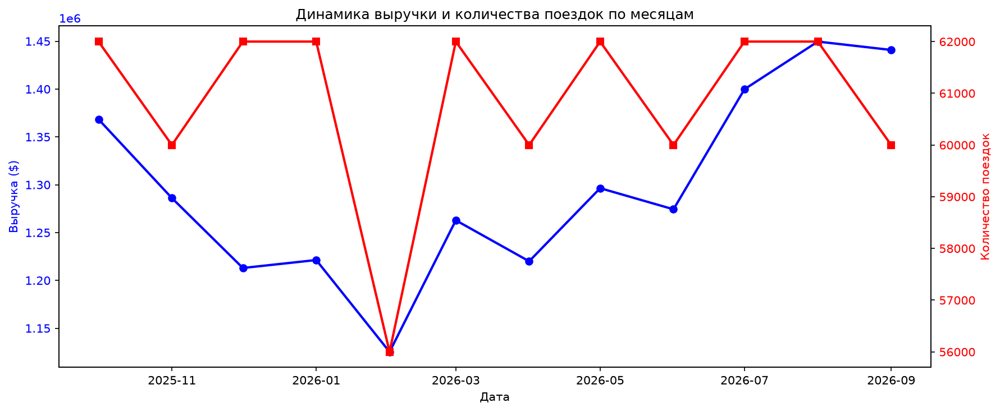
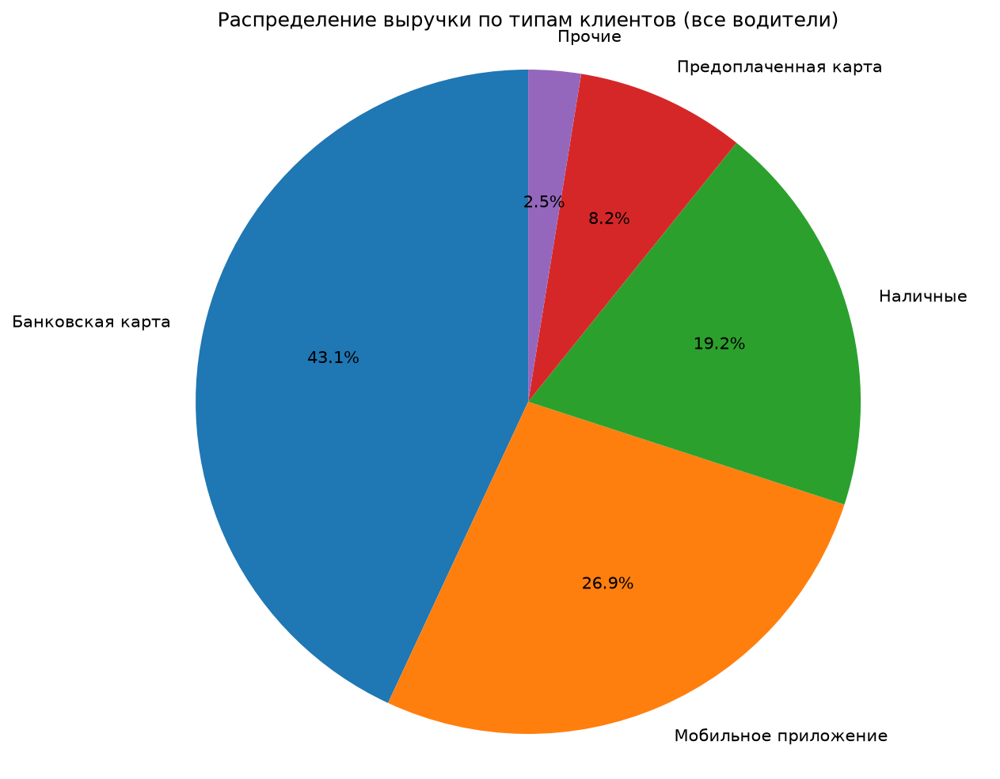

# TAXI DB

База данных PostgreSQL на **реальных поездках такси Чикаго**: год данных, 730 000 поездок, 3 000 машин, 33 таксопарка, 77 районов города. Данные ежедневно собираются из открытого API мэрии через GitHub Actions, хранятся прямо в репозитории, загружаются в базу одной командой и анализируются SQL-запросами, представлениями, функциями PL/pgSQL, Python-отчетами и графическим интерфейсом.



## Данные

### Источник

[Chicago Data Portal — Taxi Trips](https://data.cityofchicago.org/resource/ajtu-isnz.json) (набор `ajtu-isnz`): все поездки лицензированных такси города, которые публикует мэрия Чикаго. Данные обезличены:

- машина указана хэшем `taxi_id` (в Чикаго лицензия выдается на машину, поэтому машина и водитель неразличимы);
- о пассажире известен только способ оплаты;
- время начала и окончания округлено до 15 минут;
- места посадки и высадки — до района (community area); у поездок за пределами города район не указан.

Город публикует поездки с задержкой около двух недель.

### Что лежит в репозитории

| Период | Дней | Поездок | Размер |
|---|---:|---:|---:|
| 01.10.2025 — 30.09.2026 | 365 | 730 000 | 28 МБ |

Каждый день — отдельный файл `data/chicago/rides/ГГГГ/ГГГГ-ММ-ДД.csv.gz` (около 75 КБ) с выборкой из 2000 поездок. За день в Чикаго совершается примерно 18 000 поездок, так что в репозиторий попадает равномерная выборка около 11 %. Любой клон репозитория получает ту же базу без обращения к API. Файлы пополняет GitHub Actions.

Несколько цифр по текущим данным. Доли и средние значения близки к картине по всем такси Чикаго, а суммы относятся только к выборке: реальная выручка города примерно в 9 раз больше.

| Показатель | Значение |
|---|---:|
| выручка по счетчику (выборка ~11 %) | $15,6 млн |
| средний чек | $21,31 |
| средняя поездка | 10,2 км, 19 мин |
| поездок с чаевыми | 41,8 % |
| крупнейший таксопарк | Flash Cab (21 % поездок) |
| оплата | приложение 38,6 %, карта 32,5 %, наличные 19,3 %, предоплаченная карта 7,3 % |



### Как собираются данные

1. **Сборщик** `parser/chicago_fetch.py` (только стандартная библиотека Python) запрашивает API по дням.
   - За каждый день берется 2000 поездок, упорядоченных по `trip_id`. `trip_id` — случайный хэш, поэтому выборка равномерная, а повторный запуск дает тот же результат байт в байт.
   - День сохраняется, только когда он полный: в наборе уже есть поездки следующего дня.
   - Уже скачанные дни пропускаются, сетевые ошибки повторяются.
   - Явный брак отсеивается в запросе к API: нет `taxi_id`, нулевые или невозможные длительность, пробег и стоимость.
   - `trip_id` и `taxi_id` укорачиваются до 16 символов: этого достаточно для уникальности, а файлы становятся меньше.
2. **GitHub Actions** (`.github/workflows/parser.yml`) запускает сборщик каждый день в 06:30 UTC с окном 45 дней и коммитит новые файлы. Ручной запуск: вкладка Actions → «Сбор поездок такси Чикаго» → Run workflow, в поле `days` можно указать, за сколько дней проверить пропуски.
3. **Загрузчик** `parser/load_rides.py` переносит файлы в базу через временную таблицу и `COPY`.
   - Повторный запуск добавляет только новые поездки (`trip_id` уникален).
   - Таксопарки, водители и способы оплаты пополняются из тех же файлов. Названия таксопарков сравниваются без учета регистра и лишних пробелов: город пишет один и тот же парк по-разному.
   - Мили переводятся в километры, секунды — в минуты, платные дороги и доплаты складываются в «сборы».
   - Способы оплаты получают русские названия; отрицательные чаевые и сборы (корректировки) считаются нулем.

Суммы — в долларах США.

## Быстрый запуск

Нужны PostgreSQL, Python 3 и Git (в Windows — Git for Windows, из него берется bash).

**Linux и macOS:**

```bash
createdb taxi
python3 -m pip install -r requirements.txt
./help.sh rebuild        # схема, справочники и все поездки из data/chicago/rides (~3 минуты)
./help.sh task1          # выручка по сезонам
./run_app.sh             # графический интерфейс
```

**Windows (PowerShell или cmd):**

```powershell
createdb -U postgres taxi
python -m pip install -r requirements.txt
.\help.cmd rebuild
.\help.cmd task1
.\run_app.cmd
```

`help.cmd`, `python_reports.cmd` и `run_app.cmd` — обертки для Windows: находят bash из Git for Windows, переключают консоль в UTF-8 и запускают одноименный `.sh` с теми же параметрами. Все команды ниже работают одинаково: `./help.sh 04` в Linux — это `.\help.cmd 04` в Windows. Служебные надписи psql в Windows выводятся на английском (`(1 row)`): русские psql пишет в кодировке ANSI, и в UTF-8-консоли они нечитаемы. Данные и заголовки остаются русскими.

### Обновление данных

После `git pull` (новые дни, собранные GitHub Actions):

```bash
./help.sh load           # только новые поездки
```

Скачать недостающие дни самостоятельно, без GitHub Actions:

```bash
./help.sh fetch          # проверить последние 45 дней
./help.sh fetch 365      # за год
./help.sh load
```

Или с точными датами: `python3 parser/chicago_fetch.py --from 2026-01-01 --to 2026-01-31`. Параметр `--per-day` меняет размер выборки за день (по умолчанию 2000).

`./help.sh rebuild` пересоздает все таблицы: ручные изменения в базе пропадут.

## Конфигурация подключения

Настройки подключения задаются в одном месте — стандартными переменными PostgreSQL. Их читают GUI, Python-скрипты (через `app/scripts/db_config.py`) и shell-скрипты (через `psql`):

| Переменная | По умолчанию |
|---|---|
| `PGDATABASE` | `taxi` |
| `PGHOST` | `localhost` |
| `PGPORT` | `5432` |
| `PGUSER` | имя пользователя ОС |
| `PGPASSWORD` | пусто |

Если значения по умолчанию подходят, ничего настраивать не нужно. Иначе скопируйте `.env.example` в `.env` и укажите свои значения (в Windows обычно `PGUSER=postgres`). Файл `.env` не попадает в git. Скрипты можно запускать из любой папки: они сами находят корень проекта.

## Структура базы данных

| Таблица | Назначение |
|---|---|
| `ТАКСОПАРКИ` | таксопарки Чикаго (поле `company` данных города) |
| `ВОДИТЕЛИ` | такси с водителем: обезличенный `taxi_id` |
| `КЛИЕНТЫ` | типы клиентов по способу оплаты: карта, наличные, приложение, предоплаченная карта и т. д. |
| `РАЙОНЫ` | 77 районов Чикаго с координатами центра |
| `ПОЕЗДКИ` | поездки: время начала и окончания, водитель, тип клиента, таксопарк, районы посадки и высадки, километры, минуты, стоимость, чаевые, сборы |
| `СЕЗОН` | соответствие месяца сезону для аналитики |

Связи:

- `ПОЕЗДКИ.водитель` → `ВОДИТЕЛИ.код`;
- `ПОЕЗДКИ.клиент` → `КЛИЕНТЫ.код`;
- `ПОЕЗДКИ.таксопарк` → `ТАКСОПАРКИ.код`;
- `ПОЕЗДКИ.откуда`, `ПОЕЗДКИ.куда` → `РАЙОНЫ.код` (пусто, если поездка началась или закончилась за городом).

Водитель, клиент и таксопарк поездки обязательны (`NOT NULL`), удалить их, пока на них ссылаются поездки, нельзя (`ON DELETE RESTRICT`). `ПОЕЗДКИ.trip_id` уникален: одна и та же поездка не загрузится дважды. Таксопарки уникальны без учета регистра. Стоимость, километры и минуты положительны, чаевые и сборы неотрицательны (`CHECK`).

Индексы: по дате поездки и всем внешним ключам.

### Объем данных

| Таблица | Строк |
|---|---:|
| `ПОЕЗДКИ` | 730 000 (2000 в день, растет ежедневно) |
| `ВОДИТЕЛИ` | ~3 000 |
| `ТАКСОПАРКИ` | ~33 |
| `КЛИЕНТЫ` | 8 |
| `РАЙОНЫ` | 77 |
| `СЕЗОН` | 12 |

Фактические значения текущей базы: `./help.sh 04` и `./help.sh 16`.

## SQL-команды

Основной запускатель SQL-команд: `./help.sh` (в Windows `.\help.cmd`), без параметров выводит полное меню.

### Данные

| Команда | Описание |
|---|---|
| `./help.sh fetch [дней]` | скачать недостающие дни из открытых данных Чикаго |
| `./help.sh load` | загрузить скачанные поездки в базу (только новые) |
| `./help.sh rebuild` | пересоздать базу и загрузить все поездки |

### Основные задачи

| Команда | Описание |
|---|---|
| `./help.sh task1` | выручка по сезонам |
| `./help.sh task2` | выручка по сезонам и таксопаркам |
| `./help.sh task3` | выручка по дням недели и водителям (топ-5 в каждый день) |
| `./help.sh task4 N` | выручка по водителям за день недели N (1 — пн ... 7 — вс) |

### Просмотр данных

| Команда | Описание |
|---|---|
| `./help.sh 01` | все таксопарки |
| `./help.sh 02` | водители (первые 50) |
| `./help.sh 03` | типы клиентов |
| `./help.sh 04` | количество поездок и период данных |
| `./help.sh 05` | последние поездки |
| `./help.sh 06` | типы клиентов с числом поездок |
| `./help.sh 16` | структура таблиц |

### JOIN и операции изменения данных

| Команда | Описание |
|---|---|
| `./help.sh 07` | INNER JOIN: поездки с таксопарком и водителем |
| `./help.sh 08` | LEFT JOIN: районы с наименьшим числом поездок |
| `./help.sh 09` | RIGHT JOIN: типы клиентов и их поездки |
| `./help.sh 10` | FULL JOIN |
| `./help.sh 11` | CROSS JOIN: таксопарки × типы клиентов |
| `./help.sh 12` | SELF JOIN: соседние районы |
| `./help.sh 60` - `./help.sh 65` | UPDATE и DELETE с состоянием до и после |

Демонстрационные скрипты в `queries/update`, `queries/delete`, `queries/insert` выполняются в транзакции с `ROLLBACK` и не меняют базу.

### Аналитика

| Команда | Описание |
|---|---|
| `./help.sh 17` | топ-10 районов посадки по выручке |
| `./help.sh 18` | топ-10 водителей по выручке |
| `./help.sh 19` | выручка по месяцам |
| `./help.sh 20` | средний чек |
| `./help.sh 21` | поездки по часам |
| `./help.sh 22` | статистика по таксопаркам |
| `./help.sh 23` | загруженность водителей |
| `./help.sh 24` | средние чаевые по типам клиентов |
| `./help.sh 25` | выручка по дням недели |
| `./help.sh 26` | выручка по типам клиентов |
| `./help.sh 27` | средний пробег по таксопаркам |
| `./help.sh 28` | распределение поездок по часам |
| `./help.sh 29` | средний чек по часам |
| `./help.sh 30` | топ-10 водителей по чаевым |

### Запросы с параметрами

| Команда | Описание |
|---|---|
| `./help.sh 31 текст` | таксопарки по части названия |
| `./help.sh 32 код` | информация о водителе |
| `./help.sh 33 код` | последние поездки водителя |
| `./help.sh 34 сумма` | поездки дороже суммы |
| `./help.sh 35 сумма` | водители с выручкой выше суммы |
| `./help.sh 40 код название` | переименовать таксопарк |
| `./help.sh 41 код описание` | изменить описание типа клиента |
| `./help.sh 42 код` | удалить водителя вместе с поездками |
| `./help.sh 43 название` | добавить таксопарк |
| `./help.sh 44 taxi_id` | добавить водителя |
| `./help.sh 45 код_поездки код_таксопарка` | сменить таксопарк поездки |
| `./help.sh 46 код_поездки сумма` | изменить чаевые поездки |
| `./help.sh файл.sql [параметр]` | выполнить SQL-файл; параметр доступен в нем как `:arg1` |

Числовые параметры проверяются, в текстовых экранируются кавычки. Текстовые параметры могут быть на русском и в Windows.

### Представления и подзапросы

| Команда | Описание |
|---|---|
| `./help.sh 100` | создать пользовательское представление `v_rides_user` |
| `./help.sh 101` | создать технологическое представление `v_rides_tech` |
| `./help.sh 102` | проверить представления |
| `./help.sh 110` - `./help.sh 118` | задачи с подзапросами |
| `./help.sh 199` | выполнить все запросы с подзапросами |

### Функции PostgreSQL

| Команда | Описание |
|---|---|
| `./help.sh 200` | создать все функции |
| `./help.sh 201 порог` | водители с выручкой выше порога |
| `./help.sh 202` | выручка по таксопаркам и сезонам |
| `./help.sh 203` | сводная таблица водители × способы оплаты |
| `./help.sh 204` | выполнить все функции |

Функции: `get_driver_revenue(INT)`, `drivers_above_revenue(NUMERIC)`, `get_company_avg_revenue(VARCHAR)`, `revenue_by_company_and_season()`, `get_driver_revenue_by_client(INT, VARCHAR)`, `display_pivot_table()`.

## Python-отчеты

Запускатель: `./python_reports.sh` (в Windows `.\python_reports.cmd`).

| Команда | Описание |
|---|---|
| `./python_reports.sh 1 [код_водителя] [тип_клиента]` | выручка по водителям и типам клиентов |
| `./python_reports.sh 1s [код_водителя] [тип_клиента]` | то же со звездочкой в углу таблицы |
| `./python_reports.sh 2 [тип_клиента]` | сводные матрицы выручки и числа поездок |
| `./python_reports.sh 3` | график динамики выручки и числа поездок по месяцам |
| `./python_reports.sh 4 [код_водителя]` | круговая диаграмма выручки по типам клиентов |
| `./python_reports.sh save [--force]` | сохранить графики в `docs/` (`--force` — перезаписать без вопроса) |
| `./python_reports.sh all` | выполнить все отчеты |

Без кода водителя отчеты показывают 15 водителей с наибольшей выручкой. Если график уже есть, отчет спрашивает, перезаписать ли его; без терминала (например, из GUI) файл не перезаписывается — нужен `--force`. На круговой диаграмме доли меньше 3 % объединяются в «Прочие».

## Графический интерфейс

`./run_app.sh` (в Windows `.\run_app.cmd`) запускает `app/gui.py`:

- дашборд с ключевыми показателями;
- просмотр и фильтрация поездок по таксопарку, водителю, типу клиента, районам, дате и сумме;
- рейтинги, аналитика по периодам, дням недели и часам, проверка качества данных;
- графики matplotlib;
- добавление, редактирование и удаление записей, UPDATE и DELETE с состоянием до и после;
- триграммный поиск (`pg_trgm`);
- экспорт в CSV, резервная копия через `pg_dump`;
- запуск SQL-скриптов проекта и всех команд `help.sh` и `python_reports.sh`.

## Проверка

Все команды `help.sh` и `python_reports.sh`, все SQL-файлы и отчеты, графики и операции с записями в GUI проверены на полном наборе данных (730 000 поездок) в Windows 11 с PostgreSQL 18 и Python 3.12.

## Структура проекта

```text
TAXI/
├── .github/workflows/parser.yml   ежедневный сбор данных
├── help.sh / help.cmd             меню SQL-команд (Linux / Windows)
├── python_reports.sh / .cmd       меню Python-отчетов
├── run_app.sh / .cmd              запуск GUI
├── run_sql.sh                     запуск SQL-файла с параметром
├── taxi_report.py                 Python-отчеты и графики
├── app/
│   ├── gui.py
│   └── scripts/db_config.py       настройки подключения
├── data/
│   ├── chicago/
│   │   ├── community_areas.csv    77 районов Чикаго
│   │   └── rides/ГГГГ/*.csv.gz    поездки по дням
│   └── season/
├── docs/                          графики
├── helper/                        вспомогательные запросы
├── parser/
│   ├── chicago_fetch.py           сбор из API Чикаго
│   └── load_rides.py              загрузка в базу
├── queries/
│   ├── delete/ insert/ update/    демонстрации изменения данных
│   ├── functions/                 функции PL/pgSQL
│   ├── subqueries/                подзапросы
│   ├── tasks/                     основные задачи
│   └── views/                     представления
├── schema/
│   ├── indexes/
│   └── tables/
└── setup/
    ├── rebuild.sh                 полная пересборка
    └── rebuild_database.sql       схема, справочники, функции
```

## Примечания

- Имена таблиц и полей русские, поэтому терминал и редактор должны работать в UTF-8 (в Windows это делают обертки `.cmd`).
- Названия таксопарков и районов — как в данных города, на английском.
- `.gitattributes` закрепляет переводы строк: `.sh` всегда с LF (с CRLF bash их не выполнит), `.cmd` — с CRLF.
- Расписание GitHub Actions работает только из ветки по умолчанию (`main`).
