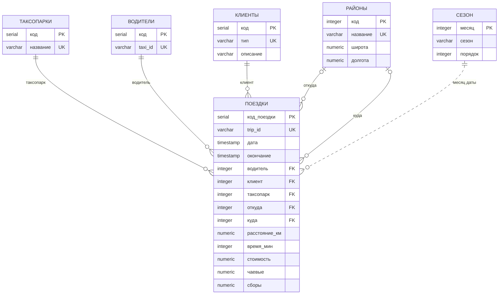

# База данных TAXI

Описание базы PostgreSQL с поездками такси Чикаго: таблицы и поля, связи, ограничения, индексы, представления, функции, загрузка данных и обслуживание.

Версия Word: [DATABASE.docx](DATABASE.docx). Обе версии собираются из этого файла командой `python docs/make_docs.py`.

## 1. Общие сведения

| Параметр | Значение |
|---|---|
| СУБД | PostgreSQL 13 и новее (проверено на 18) |
| Имя базы | `taxi` (меняется переменной `PGDATABASE`) |
| Кодировка | UTF-8: имена таблиц и полей русские |
| Схема | `public` |
| Расширения | `plpgsql`, `pg_trgm` (триграммный поиск в GUI) |
| Источник данных | Chicago Data Portal, набор Taxi Trips (`ajtu-isnz`) |
| Период | 01.10.2025 — 30.09.2026; сборщик проверяет новые данные каждый день, город выкладывает их раз в месяц |
| Объем | 730 000 поездок, около 180 МБ на диске |
| Денежные суммы | доллары США |

Город публикует все поездки лицензированных такси Чикаго, примерно 18 000 в день. В базу попадает равномерная выборка: 2000 поездок за каждый день, около 11 % всех поездок. Доли и средние значения по выборке близки к картине по всему городу, а суммы примерно в 9 раз меньше реальных (подробнее — в разделе 11).

Данные обезличены городом:

- машина указана хэшем `taxi_id`; в Чикаго лицензия выдается на машину, поэтому водитель и машина неразличимы;
- о пассажире известен только способ оплаты;
- время начала и окончания округлено до 15 минут;
- места посадки и высадки указаны с точностью до района (community area).

## 2. Схема данных



`ПОЕЗДКИ` — таблица фактов, остальные — справочники. `СЕЗОН` не связан внешним ключом: сезон поездки находится по месяцу даты, `СЕЗОН.месяц = EXTRACT(MONTH FROM ПОЕЗДКИ.дата)`.

## 3. Таблицы

Обозначения в столбце «Ограничения»: PK — первичный ключ, FK — внешний ключ, UK — уникальное значение, NN — обязательное поле (`NOT NULL`).

### 3.1. ТАКСОПАРКИ

Таксопарки Чикаго — поле `company` в данных города. Пополняется при загрузке поездок.

| Поле | Тип | Ограничения | Описание | Пример |
|---|---|---|---|---|
| `код` | `SERIAL` | PK | внутренний код | 15 |
| `название` | `VARCHAR(100)` | NN, UK без учета регистра | название, как его пишет город | Flash Cab |

Город пишет один и тот же парк по-разному («Agency  LLC» и «Agency Llc»). Поэтому загрузчик убирает лишние пробелы, а уникальный индекс `uq_companies_name` по `lower(название)` не дает завести два парка, отличающихся только регистром. Поездки без таксопарка получают парк «Не указан».

Строк: 33.

### 3.2. ВОДИТЕЛИ

Такси вместе с водителем. Город публикует только обезличенный идентификатор машины.

| Поле | Тип | Ограничения | Описание | Пример |
|---|---|---|---|---|
| `код` | `SERIAL` | PK | внутренний код; в отчетах выводится как «Водитель №код» | 1 |
| `taxi_id` | `VARCHAR(16)` | NN, UK | хэш машины из данных города, укороченный до 16 символов | 17a313ad40ea4108 |

Строк: около 3 000.

### 3.3. КЛИЕНТЫ

Типы клиентов. О пассажире город сообщает только способ оплаты, поэтому клиент описывается тем, как он платит.

| Поле | Тип | Ограничения | Описание | Пример |
|---|---|---|---|---|
| `код` | `SERIAL` | PK | внутренний код | 2 |
| `тип` | `VARCHAR(30)` | NN, UK | способ оплаты из данных города | Credit Card |
| `описание` | `VARCHAR(50)` | NN | русское название для отчетов | Банковская карта |

Полный список значений — в разделе 10.1. Новый способ оплаты, если город его введет, добавится автоматически с описанием, равным типу.

### 3.4. РАЙОНЫ

77 районов Чикаго (community areas) с координатами центра. Загружается из `data/chicago/community_areas.csv` при пересборке базы.

| Поле | Тип | Ограничения | Описание | Пример |
|---|---|---|---|---|
| `код` | `INTEGER` | PK, от 1 до 77 | номер района, принятый в Чикаго | 32 |
| `название` | `VARCHAR(50)` | NN, UK | название района | Loop |
| `широта` | `NUMERIC(9,6)` | | широта центра района | 41.884987 |
| `долгота` | `NUMERIC(9,6)` | | долгота центра района | -87.620993 |

### 3.5. ПОЕЗДКИ

Поездки такси. Каждая строка — одна поездка из данных города.

| Поле | Тип | Ограничения | Описание | Пример |
|---|---|---|---|---|
| `код_поездки` | `SERIAL` | PK | внутренний код | 1 |
| `trip_id` | `VARCHAR(16)` | NN, UK | ID поездки в данных города; защищает от повторной загрузки | 0056e8e37f93908b |
| `дата` | `TIMESTAMP` | NN | начало поездки, округлено до 15 минут | 2025-10-01 12:45 |
| `окончание` | `TIMESTAMP` | не раньше `дата` | конец поездки, округлен до 15 минут | 2025-10-01 12:45 |
| `водитель` | `INTEGER` | NN, FK → `ВОДИТЕЛИ.код` | такси с водителем | 2358 |
| `клиент` | `INTEGER` | NN, FK → `КЛИЕНТЫ.код` | тип клиента (способ оплаты) | 7 |
| `таксопарк` | `INTEGER` | NN, FK → `ТАКСОПАРКИ.код` | таксопарк | 15 |
| `откуда` | `INTEGER` | FK → `РАЙОНЫ.код` | район посадки; пусто, если посадка за городом | 77 |
| `куда` | `INTEGER` | FK → `РАЙОНЫ.код` | район высадки; пусто, если высадка за городом | 3 |
| `расстояние_км` | `NUMERIC(8,2)` | NN, больше 0 | пробег, переведен из миль | 1.08 |
| `время_мин` | `INTEGER` | NN, больше 0 | длительность в минутах, не меньше 1 | 3 |
| `стоимость` | `NUMERIC(10,2)` | NN, больше 0 | стоимость по счетчику | 5.00 |
| `чаевые` | `NUMERIC(10,2)` | NN, не меньше 0, по умолчанию 0 | чаевые | 0.00 |
| `сборы` | `NUMERIC(10,2)` | NN, не меньше 0, по умолчанию 0 | платные дороги и доплаты | 0.00 |

Особенности данных:

- время округлено до 15 минут, поэтому у коротких поездок `окончание` часто совпадает с `дата`; точная длительность — в `время_мин`;
- у 1,7 % поездок не указан район посадки, у 7,4 % — район высадки: поездка началась или закончилась за пределами города;
- выручка в отчетах считается по полю `стоимость`; полная сумма, которую заплатил пассажир, — `стоимость + чаевые + сборы`.

### 3.6. СЕЗОН

Справочник для группировки по сезонам: месяц → сезон.

| Поле | Тип | Ограничения | Описание | Пример |
|---|---|---|---|---|
| `месяц` | `INTEGER` | PK, от 1 до 12 | номер месяца | 12 |
| `сезон` | `VARCHAR(10)` | NN, одно из: зима, весна, лето, осень | сезон | зима |
| `порядок` | `INTEGER` | NN, от 1 до 4 | порядок сезона при сортировке | 1 |

Полный список — в разделе 10.2.

### 3.7. ПОЕЗДКИ_АРХИВ (необязательная)

Создается кнопкой «Архивация поездок» в GUI: старые поездки переносятся сюда из `ПОЕЗДКИ`. Структура такая же, как у `ПОЕЗДКИ` (`LIKE ПОЕЗДКИ INCLUDING ALL`). В обычной базе этой таблицы нет; пересборка ее удаляет.

## 4. Связи и ссылочная целостность

| Внешний ключ | Ссылается на | Обязателен | При удалении родителя |
|---|---|---|---|
| `ПОЕЗДКИ.водитель` | `ВОДИТЕЛИ.код` | да | запрещено (`RESTRICT`) |
| `ПОЕЗДКИ.клиент` | `КЛИЕНТЫ.код` | да | запрещено (`RESTRICT`) |
| `ПОЕЗДКИ.таксопарк` | `ТАКСОПАРКИ.код` | да | запрещено (`RESTRICT`) |
| `ПОЕЗДКИ.откуда` | `РАЙОНЫ.код` | нет | запрещено (по умолчанию `NO ACTION`) |
| `ПОЕЗДКИ.куда` | `РАЙОНЫ.код` | нет | запрещено (по умолчанию `NO ACTION`) |

Водителя, тип клиента, таксопарк или район нельзя удалить, пока на них ссылается хотя бы одна поездка. Чтобы удалить водителя, сначала удаляются его поездки: так делает `./help.sh delete-driver код`.

Остальные правила целостности:

- `trip_id` уникален — одна поездка не загрузится дважды;
- `taxi_id`, `КЛИЕНТЫ.тип` и `РАЙОНЫ.название` уникальны, названия таксопарков уникальны без учета регистра;
- проверки `CHECK`: стоимость, пробег и длительность больше нуля, чаевые и сборы не меньше нуля, окончание поездки не раньше начала, код района от 1 до 77, месяц от 1 до 12, сезон из четырех значений.

## 5. Индексы

Помимо индексов первичных ключей и уникальных полей:

| Индекс | Таблица | Поле | Для чего |
|---|---|---|---|
| `idx_rides_date` | `ПОЕЗДКИ` | `дата` | фильтры по периоду, последние поездки, группировка по дням и месяцам |
| `idx_rides_driver` | `ПОЕЗДКИ` | `водитель` | поездки и выручка водителя |
| `idx_rides_client` | `ПОЕЗДКИ` | `клиент` | отчеты по способам оплаты |
| `idx_rides_company` | `ПОЕЗДКИ` | `таксопарк` | отчеты по таксопаркам |
| `idx_rides_from` | `ПОЕЗДКИ` | `откуда` | отчеты по районам посадки |
| `idx_rides_to` | `ПОЕЗДКИ` | `куда` | отчеты по районам высадки |
| `uq_companies_name` | `ТАКСОПАРКИ` | `lower(название)` | уникальность и поиск названия без учета регистра |

Файл: `schema/indexes/01_create_indexes.sql`.

## 6. Представления

### 6.1. v_rides_user — пользовательское

Поездки с понятными названиями вместо кодов. Файл: `queries/views/01_create_rides_view.sql`.

| Поле | Откуда |
|---|---|
| `код_поездки`, `дата` | `ПОЕЗДКИ` |
| `водитель` | «Водитель №» + `ПОЕЗДКИ.водитель` |
| `таксопарк` | `ТАКСОПАРКИ.название` |
| `оплата` | `КЛИЕНТЫ.описание` |
| `откуда`, `куда` | `РАЙОНЫ.название`; пусто, если район не указан |
| `расстояние_км`, `время_мин`, `стоимость`, `чаевые` | `ПОЕЗДКИ` |

### 6.2. v_rides_tech — технологическое

Коды связей рядом с названиями и исходные идентификаторы города: для проверки данных и отладки. Файл: `queries/views/02_create_rides_tech.sql`.

Поля: `код_поездки`, `trip_id`, `дата`, `окончание`, `водитель_код`, `taxi_id`, `таксопарк_код`, `таксопарк`, `клиент_код`, `тип_оплаты`, `откуда_код`, `откуда`, `куда_код`, `куда`, `расстояние_км`, `время_мин`, `стоимость`, `чаевые`, `сборы`.

В обоих представлениях районы присоединяются через `LEFT JOIN`, поэтому поездки за город не теряются.

## 7. Функции

Все функции написаны на PL/pgSQL и считают выручку по полю `стоимость`. Файлы: `queries/functions/01–03`.

| Функция | Возвращает | Что делает |
|---|---|---|
| `get_driver_revenue(p_driver_code INT)` | `NUMERIC(10,2)` | выручка водителя; 0, если поездок нет |
| `drivers_above_revenue(p_min_revenue NUMERIC DEFAULT 10000)` | таблица `водитель_код, водитель, поездок, выручка` | водители с выручкой не меньше порога, по убыванию выручки |
| `get_company_avg_revenue(p_company_name VARCHAR)` | `NUMERIC(10,2)` | средняя стоимость поездки в таксопарке; название сравнивается точно |
| `revenue_by_company_and_season()` | таблица `таксопарк, сезон, выручка, количество_поездок, порядок_сезона` | выручка каждого таксопарка по сезонам |
| `get_driver_revenue_by_client(p_driver_code INT, p_client_type VARCHAR)` | `NUMERIC(10,2)` | выручка водителя с одним способом оплаты; тип — значение `КЛИЕНТЫ.тип` (`Cash`, `Credit Card`, …) |
| `display_pivot_table()` | таблица `водитель, карта, наличные, приложение, предоплата` | сводная таблица: 15 водителей с наибольшей выручкой × 4 основных способа оплаты |

Примеры:

```sql
SELECT get_driver_revenue(1);
SELECT * FROM drivers_above_revenue(10000) LIMIT 10;
SELECT get_company_avg_revenue('Flash Cab');
SELECT * FROM revenue_by_company_and_season() WHERE таксопарк = 'Sun Taxi';
SELECT get_driver_revenue_by_client(1, 'Cash');
SELECT * FROM display_pivot_table();
```

## 8. Загрузка данных

### 8.1. Путь данных

1. Сборщик `parser/chicago_fetch.py` скачивает из API города по 2000 поездок за каждый день и сохраняет их в `data/chicago/rides/ГГГГ/ГГГГ-ММ-ДД.csv.gz`. Ежедневно его запускает GitHub Actions и коммитит новые файлы в репозиторий.
2. Загрузчик `parser/load_rides.py` (`./help.sh load`) читает файлы за дни, которых еще нет в базе, через `COPY` во временную таблицу и одной транзакцией переносит их в таблицы базы.
3. Справочники `ТАКСОПАРКИ`, `ВОДИТЕЛИ` и `КЛИЕНТЫ` пополняются из тех же файлов, `РАЙОНЫ` и `СЕЗОН` — при пересборке базы.

### 8.2. Соответствие полей

| Поле в данных города | Куда попадает | Преобразование |
|---|---|---|
| `trip_id` | `ПОЕЗДКИ.trip_id` | первые 16 символов |
| `taxi_id` | `ВОДИТЕЛИ.taxi_id` → `ПОЕЗДКИ.водитель` | первые 16 символов |
| `trip_start_timestamp` | `ПОЕЗДКИ.дата` | без изменений |
| `trip_end_timestamp` | `ПОЕЗДКИ.окончание` | без изменений |
| `trip_seconds` | `ПОЕЗДКИ.время_мин` | секунды / 60 с округлением, не меньше 1 |
| `trip_miles` | `ПОЕЗДКИ.расстояние_км` | мили × 1,609344, два знака |
| `pickup_community_area` | `ПОЕЗДКИ.откуда` | без изменений, может быть пустым |
| `dropoff_community_area` | `ПОЕЗДКИ.куда` | без изменений, может быть пустым |
| `fare` | `ПОЕЗДКИ.стоимость` | без изменений |
| `tips` | `ПОЕЗДКИ.чаевые` | пусто и отрицательные значения → 0 |
| `tolls` + `extras` | `ПОЕЗДКИ.сборы` | сумма, отрицательная → 0 |
| `payment_type` | `КЛИЕНТЫ.тип` → `ПОЕЗДКИ.клиент` | пусто → `Unknown`; русское описание по словарю |
| `company` | `ТАКСОПАРКИ.название` → `ПОЕЗДКИ.таксопарк` | лишние пробелы убираются, пусто → «Не указан» |
| `trip_total` | не хранится | итог поездки; обычно немного больше суммы стоимости, чаевых и сборов — город включает в него и другие доплаты (разница у 62 % поездок, в сумме 1,3 %) |

### 8.3. Отбор и очистка

Еще при запросе к API отбрасываются записи с явным браком:

- не указан `taxi_id`;
- длительность 0 или больше 6 часов;
- пробег 0 или больше 200 миль;
- стоимость 0 или больше $1000.

Выборка за день — первые 2000 поездок по `trip_id`. Это случайный хэш, поэтому выборка равномерная по дню, а повторное скачивание дает тот же файл. День сохраняется, только когда он полный.

### 8.4. Повторная загрузка

Загрузка идемпотентна: повторный запуск ничего не меняет.

- Загрузчик сравнивает список дней в файлах и в базе и читает только недостающие дни, включая пропуски в середине периода.
- Каждый день загружается целиком в одной транзакции.
- Поездки с уже известным `trip_id` пропускаются (`ON CONFLICT DO NOTHING`).
- `./help.sh load --all` перечитывает все файлы, например после ручного удаления части поездок.

## 9. Объекты и файлы проекта

| Объект | Файл |
|---|---|
| полная пересборка | `setup/rebuild_database.sql` (схема) и `setup/rebuild.sh` (схема + поездки) |
| таблицы | `schema/tables/01–06_create_*.sql` |
| индексы | `schema/indexes/01_create_indexes.sql` |
| справочник сезонов | `data/season/01_insert_season.sql` |
| справочник районов | `data/chicago/community_areas.csv` |
| поездки | `data/chicago/rides/ГГГГ/ГГГГ-ММ-ДД.csv.gz` |
| представления | `queries/views/01_create_rides_view.sql`, `02_create_rides_tech.sql`, проверка — `03_check_views.sql` |
| функции | `queries/functions/01–03_create_functions_task*.sql`, вызов — `04_run_functions.sql` |

## 10. Справочные значения

### 10.1. Типы клиентов

| Код | Тип | Описание | Поездок | Доля |
|---:|---|---|---:|---:|
| 1 | Mobile | Мобильное приложение | 281 737 | 38,6 % |
| 2 | Credit Card | Банковская карта | 237 206 | 32,5 % |
| 3 | Dispute | Оспоренная оплата | 320 | 0,04 % |
| 4 | Unknown | Неизвестно | 15 092 | 2,1 % |
| 5 | Prcard | Предоплаченная карта | 53 313 | 7,3 % |
| 6 | Split | Раздельная оплата | 1 | — |
| 7 | Cash | Наличные | 141 163 | 19,3 % |
| 8 | No Charge | Без оплаты | 1 168 | 0,2 % |

Коды присваиваются в порядке появления типов в данных и после пересборки могут отличаться. В запросах надежнее отбирать по полю `тип`.

### 10.2. Сезоны

| Месяцы | Сезон | Порядок |
|---|---|---:|
| 12, 1, 2 | зима | 1 |
| 3, 4, 5 | весна | 2 |
| 6, 7, 8 | лето | 3 |
| 9, 10, 11 | осень | 4 |

## 11. Статистика данных

По базе на 30.09.2026.

| Таблица | Строк | Размер с индексами |
|---|---:|---:|
| `ПОЕЗДКИ` | 730 000 | 168 МБ |
| `ВОДИТЕЛИ` | 3 059 | 0,4 МБ |
| `РАЙОНЫ` | 77 | — |
| `ТАКСОПАРКИ` | 33 | — |
| `СЕЗОН` | 12 | — |
| `КЛИЕНТЫ` | 8 | — |

| Показатель поездки | Минимум | Среднее | Максимум |
|---|---:|---:|---:|
| расстояние, км | 0,02 | 10,21 | 298,86 |
| длительность, мин | 1 | 19,4 | 360 |
| стоимость, $ | 0,01 | 21,31 | 526,84 |
| чаевые, $ | 0 | 2,49 | 105,30 |
| сборы, $ | 0 | 2,05 | 329,90 |

Крупнейшие таксопарки по числу поездок: Flash Cab (21 %), Taxicab Insurance Agency Llc (14 %), Transit Administrative Center Inc (13 %), Sun Taxi (12 %), City Service (11 %).

Выборка и все такси Чикаго за тот же период (по API города, с теми же фильтрами брака):

| Показатель | Выборка в базе | Все такси Чикаго |
|---|---:|---:|
| поездок | 730 000 | 6 546 819 |
| выручка по счетчику | $15,6 млн | $139,3 млн |
| итог с чаевыми, сборами и доплатами (`trip_total`) | $19,1 млн | $171,4 млн |

Выборка — 11,2 % поездок; чтобы оценить реальную выручку, суммы из базы нужно умножить примерно на 8,9. Итог посчитан по полю города `trip_total`, которое в базе не хранится; сумма `стоимость + чаевые + сборы` в базе — $18,9 млн (см. раздел 8.2).

Текущие значения своей базы: `./help.sh count`, `./help.sh tables`.

## 12. Типовые запросы

Выручка по месяцам:

```sql
SELECT TO_CHAR(DATE_TRUNC('month', дата), 'YYYY-MM') AS месяц,
       COUNT(*) AS поездок,
       SUM(стоимость) AS выручка
FROM ПОЕЗДКИ
GROUP BY 1
ORDER BY 1;
```

Выручка по сезонам через справочник `СЕЗОН`:

```sql
SELECT С.сезон, COUNT(*) AS поездок, SUM(П.стоимость) AS выручка
FROM ПОЕЗДКИ П
JOIN СЕЗОН С ON С.месяц = EXTRACT(MONTH FROM П.дата)
GROUP BY С.сезон, С.порядок
ORDER BY С.порядок;
```

Топ-10 районов посадки по выручке:

```sql
SELECT Р.название AS район, COUNT(*) AS поездок, SUM(П.стоимость) AS выручка
FROM ПОЕЗДКИ П
JOIN РАЙОНЫ Р ON Р.код = П.откуда
GROUP BY Р.название
ORDER BY выручка DESC
LIMIT 10;
```

Доля поездок с чаевыми по способам оплаты:

```sql
SELECT К.описание AS оплата,
       ROUND(100.0 * COUNT(*) FILTER (WHERE П.чаевые > 0) / COUNT(*), 1) AS с_чаевыми_проц
FROM ПОЕЗДКИ П
JOIN КЛИЕНТЫ К ON К.код = П.клиент
GROUP BY К.описание
ORDER BY с_чаевыми_проц DESC;
```

Последние поездки водителя через представление:

```sql
SELECT * FROM v_rides_user
WHERE водитель = 'Водитель №1'
ORDER BY дата DESC
LIMIT 10;
```

Другие готовые запросы — в папках `helper/` и `queries/` и в меню `./help.sh`.

## 13. Обслуживание

| Задача | Команда |
|---|---|
| создать базу | `createdb taxi` |
| полностью пересобрать базу | `./help.sh rebuild` — все таблицы пересоздаются, ручные изменения пропадают |
| пересоздать только схему без поездок | `psql -d taxi -f setup/rebuild_database.sql` |
| загрузить новые дни | `./help.sh load` |
| перечитать все файлы | `./help.sh load --all` |
| скачать недостающие дни из API | `./help.sh fetch [дней]` |
| пересоздать представления | `./help.sh view-user`, `./help.sh view-tech` |
| пересоздать функции | `./help.sh func-create` |
| резервная копия | `pg_dump -Fc taxi > taxi.dump` или кнопка «Бэкап» в GUI |
| восстановление | `pg_restore -d taxi --clean taxi.dump` |
| проверить базу и все запросы | `PGDATABASE=taxi_test tests/run_all.sh` |

Подключение настраивается стандартными переменными PostgreSQL (`PGHOST`, `PGPORT`, `PGUSER`, `PGPASSWORD`, `PGDATABASE`) или файлом `.env` в корне проекта — образец в `.env.example`.

Пересборка подключает `pg_trgm`. Если у пользователя нет на это прав, пересборка не прерывается, только в GUI не будет работать триграммный поиск. Подключить расширение может владелец базы: `CREATE EXTENSION pg_trgm;`.
